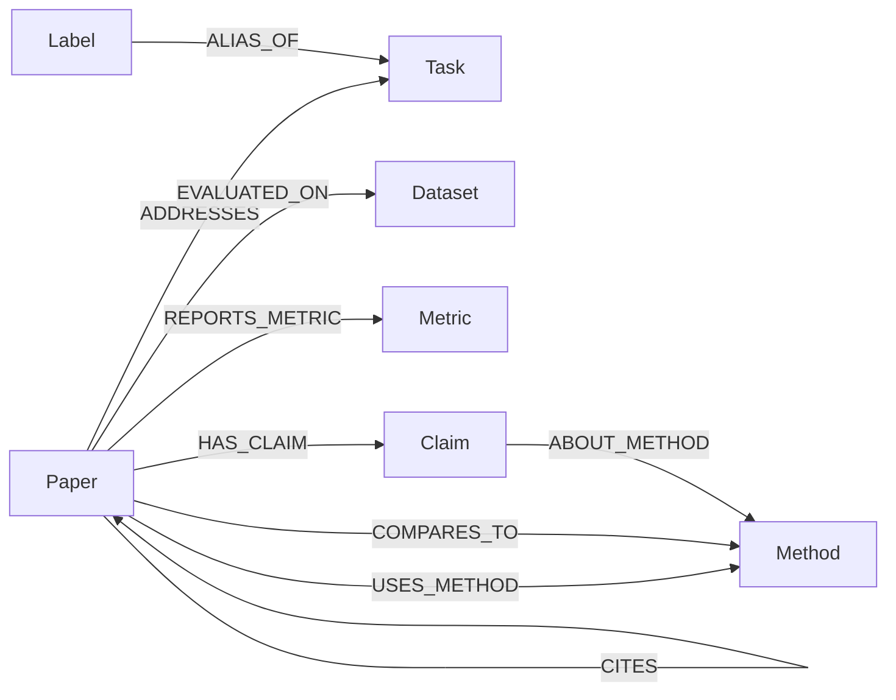
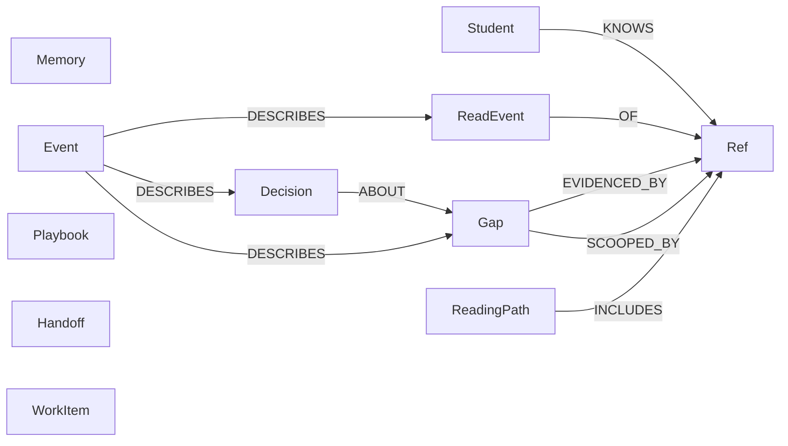
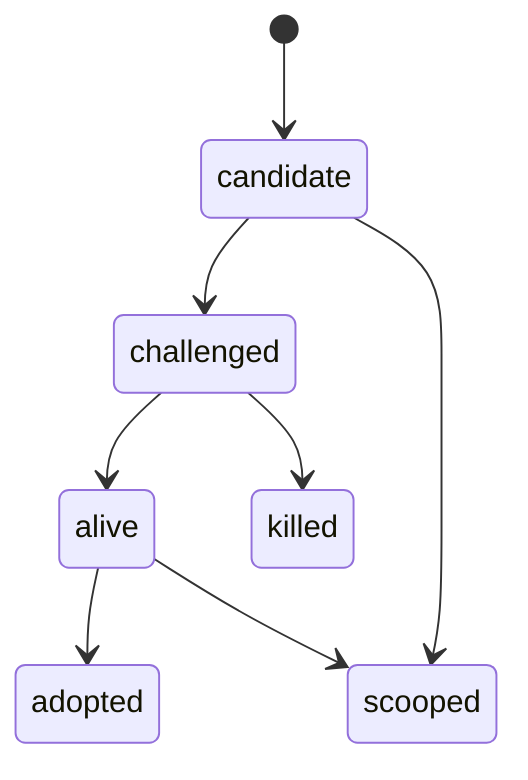

# FalkorDB graph

Two graphs share one FalkorDB instance. `frontier_corpus` is the field, and it is the only place embeddings are stored. `frontier_ws_<user>` is one student's memory. A private node stores a corpus id. It does not store a second copy of the paper.

Cypher for both graphs is in `backend/app/models/queries.py`. Citation paths use `algo.SPpaths` over `CITES`, capped at four hops.

## The corpus

`Paper` carries the arXiv id, year, layer, and the embedding used for search. `Claim` carries its own embedding. `Label` is a surface form that points at one `Task`, so "k-means" and "euclidean k-means" land on the same node.

A gap in the product is a cell this picture does not fill: a task and a method family with no paper that `ADDRESSES` the task and `USES_METHOD` the method. Search for that cell is a graph query, not a prompt.

## One student's graph

`Ref` is the join to the corpus. `kind` is `paper`, `task`, `method`, `dataset`, or `metric`, and `ref_id` is that node's id. Deleting the corpus node does not require a cascade of copied titles.

`Memory` is a fact with `valid_from` and `valid_to`. A query for "what did this student believe at time T" keeps the rows whose window covers T. Closing a window is how a later paper overturns a belief without deleting the history.

`ReadingPath` is a single node, `id: current`, ordered by `INCLUDES`. `Playbook` is the experiment plan for one gap: the dataset, metric, and baseline already present on that task in the corpus. The planner does not invent a setup the graph has never seen.

`Handoff` is how agents share work. A row names `from_agent`, `to_agent`, and a precondition such as `gap_ready_for_adversary`. The next agent accepts it only when the gap's status and evidence match that precondition. Agents do not call each other.

`WorkItem` is the queue. The worker claims one row with a single conditional update, so two workers cannot take the same job.

## A gap's life

Each move writes an `Event` in the same statement as the status change. `scooped` also adds `SCOOPED_BY` to the later paper's `Ref` and sets `valid_to` on the belief it replaced.

## Who can see what

| Caller | Corpus | Own private graph | Another student's graph |
| --- | --- | --- | --- |
| Student, in the app or over MCP | read, and the tools that search it | read and write | no |
| Supervisor | read | no | progress only: gaps, reading, decisions, timeline. No chats, no raw graph |
| Worker | read and the corpus writes for ingest | the jobs it claimed | no |
