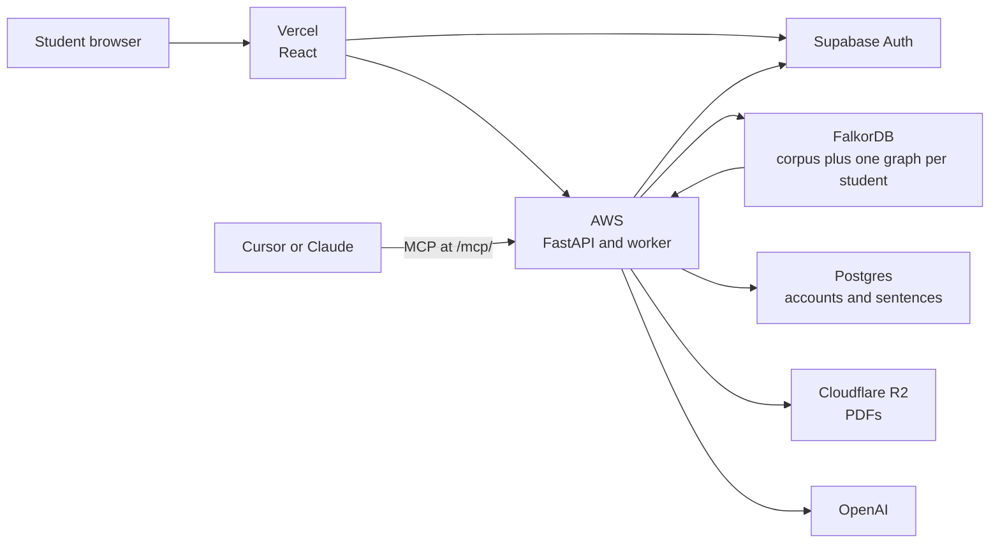

# Frontier

A research companion for computer science papers. One shared FalkorDB graph holds the field. Each student gets a private graph for what they have read, believed, and ruled out. Agents act by querying those graphs, and a coding agent can call the same tools over MCP.

**Live app:** [frontend-frontier-delta.vercel.app](https://frontend-frontier-delta.vercel.app)  
**API:** [frontier-backend-api.duckdns.org](https://frontier-backend-api.duckdns.org) · `GET /healthz`  
**Tracks:** Agents That Act on Connected Data, and Agent Memory and Coordination.

The corpus, the graph model, and the product requirements are the participant's work. Cursor was the coding assistant for the implementation. The participant reviewed the code and can explain the model, the queries, and the architecture.

## How a question moves



The web app and the MCP server call one API. Supabase signs the student in, including Google sign-in, and issues the token an external agent refreshes after the student approves it at `/oauth/consent`. FalkorDB is the system of record for papers and for memory. Postgres holds accounts, usage, and the original sentences behind a citation. R2 holds the PDFs. The API and the worker run on one AWS host. FalkorDB runs beside them, and changing the API image does not touch that container.

Remove FalkorDB and search, citation paths, gaps, notes, and scooping stop. The API cannot answer those from Postgres.

## What the agents do with the graph

An agent does not invent a reading path or a verdict and then look for support. It calls graph tools and shows the path it walked.

- **Connected reasoning.** `citation_chain` walks `CITES`. `shortest_path` calls FalkorDB `algo.SPpaths` and returns the papers on the path, at most four hops. Gap search looks for a task and method cell that the corpus has not filled, then ranks it from neighboring papers and evidence already on the graph.
- **The same tools, two doors.** The chat in the app and an external client both use the toolkit served at `https://frontier-backend-api.duckdns.org/mcp/` (keep the slash). A client that connects with no token gets a `401` pointing at `/.well-known/oauth-protected-resource`. After the student allows access, the agent can search, walk citations, record a note, and open a gap on that student's graph only. A supervisor token is refused.
- **Writes are graph transitions.** Opening a gap, challenging it, killing it, adopting it, or marking it scooped is one Cypher statement. A scoop adds `SCOOPED_BY` and closes the belief it replaced. The answer carries the tool trace and the sentence ids it used.

## What each student keeps

Memory is split by kind, and none of it is copied out of the corpus. Private nodes store ids.

| Kind | Where it lives | What it is |
| --- | --- | --- |
| Episodic | `ReadEvent`, `Decision`, `Event` | A paper read, a verdict, and the timeline of both |
| Semantic | `Memory` with `valid_from` and `valid_to` | A fact that can be closed when a later paper overturns it |
| Procedural | `ReadingPath`, `Playbook` | The order to read next, and the experiment plan that already worked for a gap |
| Conversation | chat nodes on the private graph | The thread is still there after the student leaves |
| Handoff | `Handoff` | A gap moves from one agent to the next only when its precondition holds |
| Isolation | `frontier_ws_<user>` | One graph per student. A supervisor sees progress, not chats |

The shape of both graphs, the edge list, and the lifecycle are in [GRAPH.md](GRAPH.md). Every Cypher statement the product runs is in `backend/app/models/queries.py`.

## Run it locally

The corpus is already loaded. `data/` is not part of the server. From `backend/`:

```
python -m venv .venv
.venv\Scripts\pip install -e ".[dev]"
copy .env.example .env
.venv\Scripts\uvicorn app.main:app --host 0.0.0.0 --port 8000
.venv\Scripts\python -m app.utilities.worker
```

`GET /readyz` checks FalkorDB, Postgres, and R2. The first boot applies `migrations/`.

## Connect a coding agent

```json
{ "mcpServers": { "frontier": { "url": "https://frontier-backend-api.duckdns.org/mcp/" } } }
```

Sign in as a student when the browser opens. The tools then write to that student's graph.
