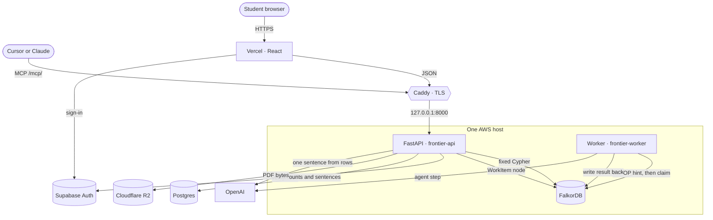
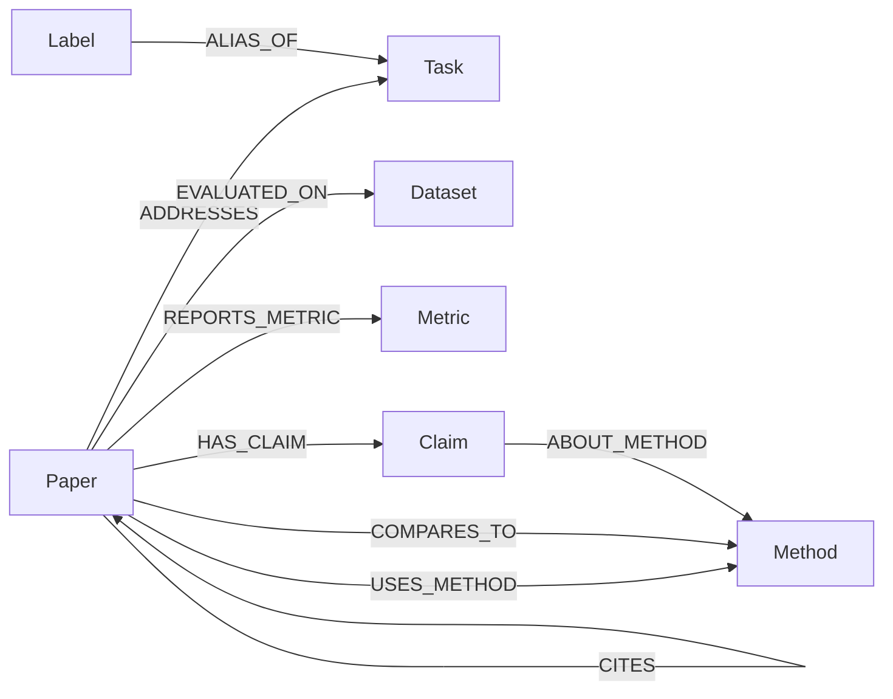
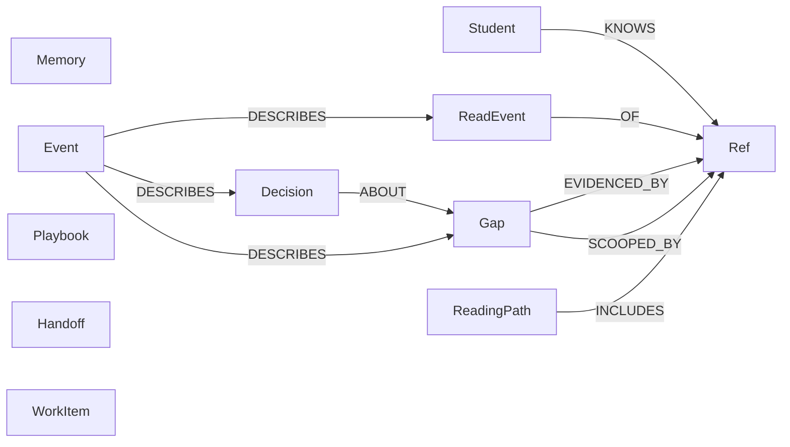
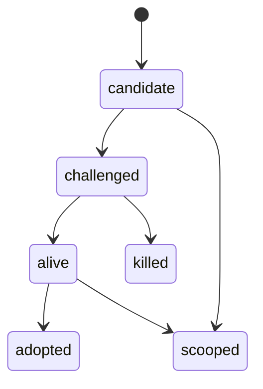

# Frontier

A research companion for computer science papers. One shared FalkorDB graph holds the field. Each student gets a private graph for what they have read, believed, and ruled out. Agents act by querying those graphs, and a coding agent can call the same tools over MCP.

**Live app:** [frontend-frontier-delta.vercel.app](https://frontend-frontier-delta.vercel.app)  
**API:** [frontier-backend-api.duckdns.org](https://frontier-backend-api.duckdns.org) · `GET /healthz`  
**Tracks:** Agents That Act on Connected Data, and Agent Memory and Coordination.

The corpus, the graph model, and the product requirements are my original work. Cursor was the coding assistant for the implementation of features and services. I have reviewed the code and can explain the model, the queries in this submission and also the underlying architecture.

## Problem Statements which my project solves

- As a novice research student, you are asked to read multiple papers from your topic of choice. Currently it is very tedious and time taking job to search relevant papers and explore their citations manually across various sites
- After scavenging multiple papers, research students need to find potential avenues for new research manually. That involves verifying the methods and claims presented by each of the hundreds of research papers.
- Research involves a lot of time. So one forgets what they read, what they decided in an earlier session. Even if they get papers reliably from LLM agents, the agents often start afresh or compress all past searches which leads to inaccurate data.

## Architecture



| Store | What it holds | What it is not for |
| --- | --- | --- |
| FalkorDB | `frontier_corpus`, one `frontier_ws_<user>` per student, the `WorkItem` queue, and the Redis hint list the worker blocks on | Accounts, PDF bytes, or model prose |
| Postgres | Accounts, usage, the original sentences behind a citation, and an index of open gaps | Paths, neighbors, or memory |
| Cloudflare R2 | The PDFs | Anything the agent reasons over |
| Supabase Auth | The student session, including Google sign-in, and the token an external agent refreshes after `/oauth/consent` | Product data |

As evident form the architecture and codebase, FalkorDB is an integral part of the project and often we have made use of graph traversal techniques and relational graph node/edge behaviour which would be tedious and difficult to implement in a flat SQL-based DB.

A request takes one of two doors and then the same tools. The browser talks to FastAPI. Cursor or Claude talks to `https://frontier-backend-api.duckdns.org/mcp/` (keep the slash). Both are checked for a student JWT. A missing token gets a `401` whose `WWW-Authenticate` header points at `/.well-known/oauth-protected-resource`. A supervisor token is refused. The model never writes Cypher. It picks a tool. The query for that tool is a string in `backend/app/models/queries.py`.

Writes that take time become a `WorkItem` node on the student's graph, plus a hint on a Redis list in the same FalkorDB process. The worker claims that row with one conditional update, so two workers cannot take the same job. Agents do not call each other. The next agent runs only when a `Handoff` precondition matches the gap's status. The handlers are GapHunter, Adversary, Chronicler, Cartographer, Reader, Evidence, and MemoryWriter.

## The corpus

Two graphs share one FalkorDB instance. `frontier_corpus` is the field, and it is the only place embeddings are stored. `frontier_ws_<user>` is one student's memory. A private node stores a corpus id. It does not store a second copy of the paper.

Cypher for both graphs is in `backend/app/models/queries.py`. Citation paths use `algo.SPpaths` over `CITES`, capped at four hops. A one-hop citation list is something a join could return. The path at two, three, or four hops is the reason this is a graph.



`Paper` carries the arXiv id, year, layer, and the embedding used for search. `Claim` carries its own embedding. `Label` is a surface form that points at one `Task`, so "k-means" and "euclidean k-means" land on the same node.

A gap in the product is a cell this picture does not fill: a task and a method family with no paper that `ADDRESSES` the task and `USES_METHOD` the method. Search for that cell is a graph query, not a prompt. An empty cell is an answer. The agent is supposed to say the corpus has no such paper, rather than invent one.

## One student's graph



`Ref` is the join to the corpus. `kind` is `paper`, `task`, `method`, `dataset`, or `metric`, and `ref_id` is that node's id. Deleting the corpus node does not require a cascade of copied titles.

Memory is more nodes on this graph, not a second database.

| Kind | Where it lives | What it is |
| --- | --- | --- |
| Episodic | `ReadEvent`, `Decision`, `Event` | A paper read, a verdict, and the timeline of both |
| Semantic | `Memory` with `valid_from` and `valid_to` | A fact that can be closed when a later paper overturns it |
| Procedural | `ReadingPath`, `Playbook` | The order to read next, and the experiment plan that already worked for a gap |
| Conversation | chat nodes on the private graph | The thread is still there after the student leaves |
| Handoff | `Handoff` | A gap moves from one agent to the next only when its precondition holds |
| Isolation | `frontier_ws_<user>` | One graph per student. A query on one graph cannot see another |

`Memory` is a fact with `valid_from` and `valid_to`. A query for "what did this student believe at time T" keeps the rows whose window covers T. Closing a window is how a later paper overturns a belief without deleting the history.

`ReadingPath` is a single node, `id: current`, ordered by `INCLUDES`. `Playbook` is the experiment plan for one gap: the dataset, metric, and baseline already present on that task in the corpus. The planner does not invent a setup the graph has never seen.

`Handoff` names `from_agent`, `to_agent`, and a precondition such as `gap_ready_for_adversary`. The next agent accepts it only when the gap's status and evidence match that precondition.

## A research gap's life



Each move is one Cypher statement, and it writes an `Event` in that same statement. `scooped` also adds `SCOOPED_BY` to the later paper's `Ref` and sets `valid_to` on the belief it replaced. The answer carries the tool trace and the sentence ids it used.

## Who can see what

| Caller | Corpus | Own private graph | Another student's graph |
| --- | --- | --- | --- |
| Student, in the app or over MCP | read, and the tools that search it | read and write | no |
| Supervisor | read | no | progress only: gaps, reading, decisions, timeline. No chats, no raw graph |
| Worker | read and the corpus writes for ingest | the jobs it claimed | no |

## What the agents do with the graph

An agent does not invent a reading path or a verdict and then look for support. It calls graph tools and shows the path it walked.

- **Connected reasoning.** `citation_chain` walks `CITES`. `shortest_path` calls FalkorDB `algo.SPpaths` and returns the papers on the path, at most four hops. Gap search looks for the empty task and method cell, then ranks it from neighboring papers and evidence already on the graph.
- **The same tools, two doors.** The chat in the app and an external client both use the toolkit at `https://frontier-backend-api.duckdns.org/mcp/`. After the student allows access, the agent can search, walk citations, record a note, and open a research gap on that student's graph only.
- **Writes are graph transitions.** Opening a gap, challenging it, killing it, adopting it, or marking it scooped does not update a status column in Postgres and then hope the graph matches. The graph row is the status.

## Run it locally

The corpus is already loaded. `data/` is not part of the server. The scripts that built the JSONL rows are in `data/`. The generated rows, embeddings, and PDFs are not in the repo. From `backend/`:

```
python -m venv .venv
.venv\Scripts\pip install -e ".[dev]"
copy .env.example .env
.venv\Scripts\uvicorn app.main:app --host 0.0.0.0 --port 8000
.venv\Scripts\python -m app.utilities.worker
```

`GET /readyz` checks FalkorDB, Postgres, and R2. The first boot applies `migrations/`.

## Connect a coding agent

```json
{ "mcpServers": { "frontier": { "url": "https://frontier-backend-api.duckdns.org/mcp/" } } }
```

Sign in as a student when the browser opens. The tools then write to that student's graph.

## Data

The papers are public computer-science work. Three free and publicly available sources were used to build the corpus:

- [arXiv](https://arxiv.org/) for the PDFs.
- The [Cornell University arXiv dataset](https://www.kaggle.com/datasets/Cornell-University/arxiv) on Kaggle for titles, abstracts, categories, and years.
- The [Semantic Scholar Academic Graph API](https://api.semanticscholar.org/api-docs/graph) for the citation edges.
